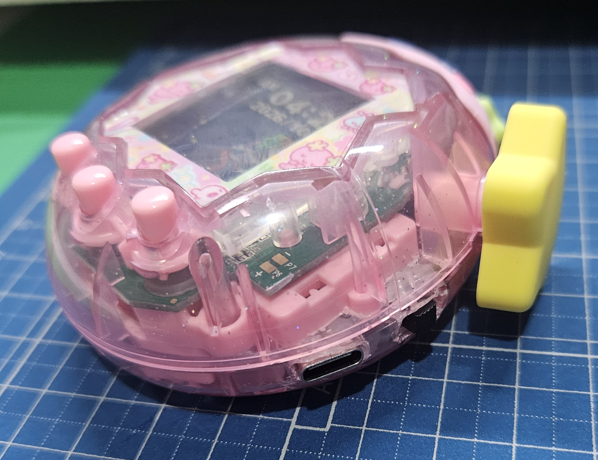
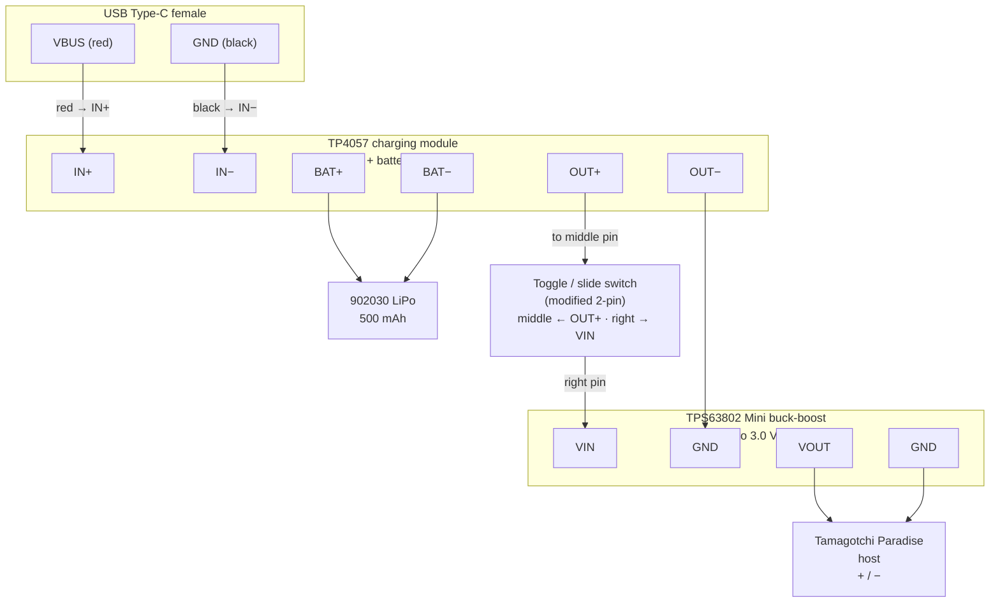
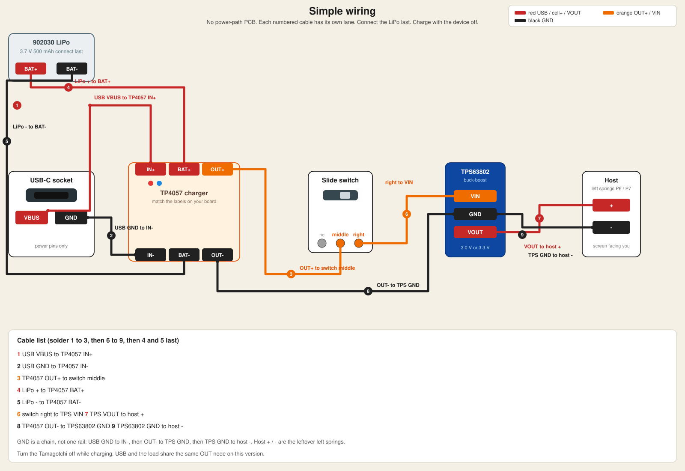
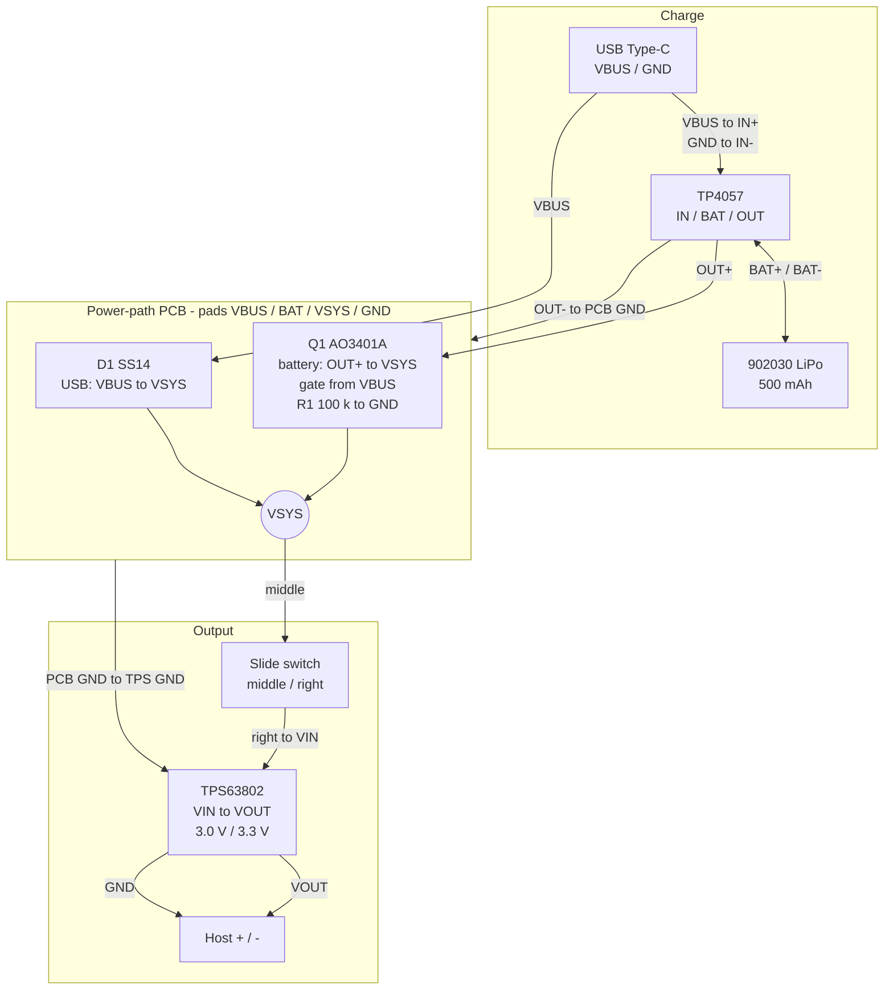
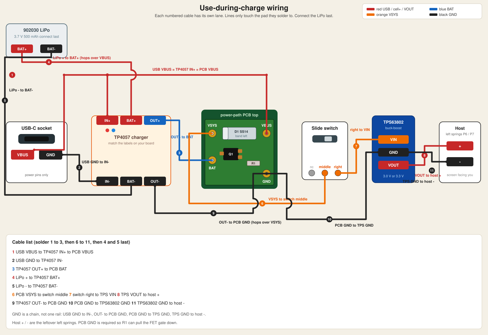
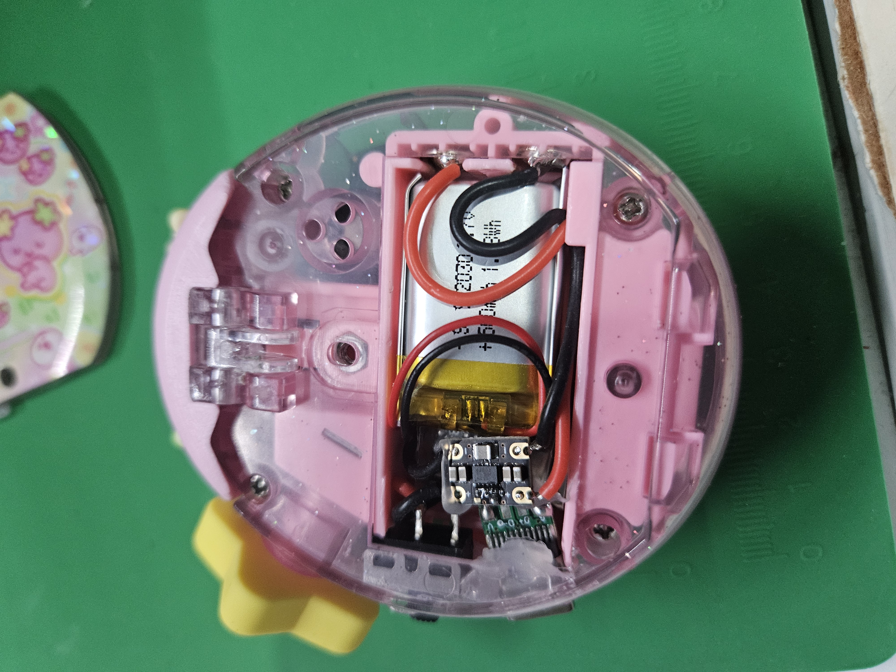
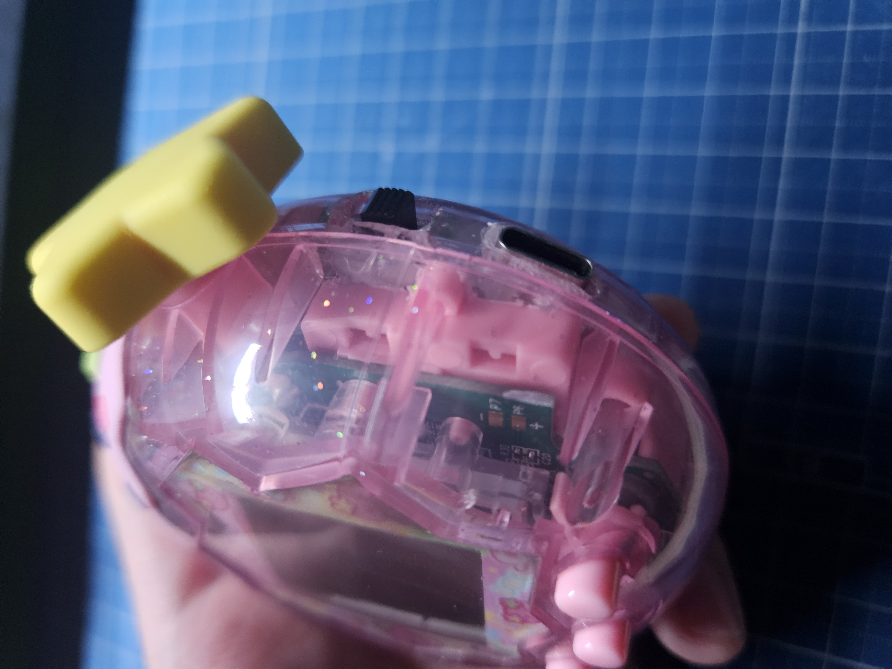
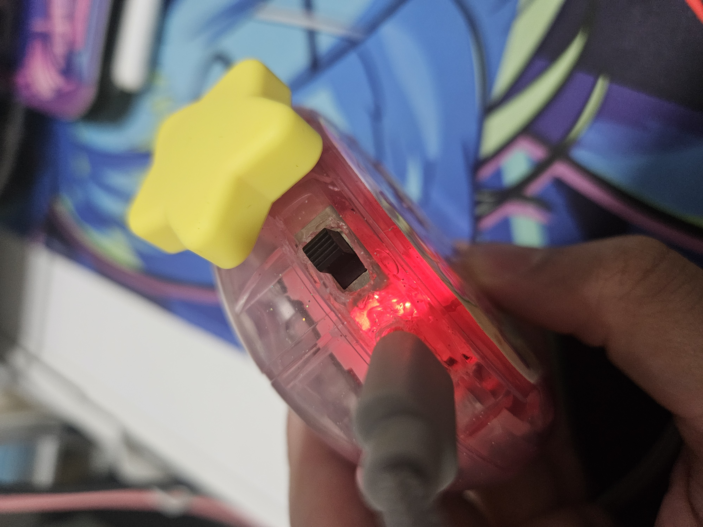
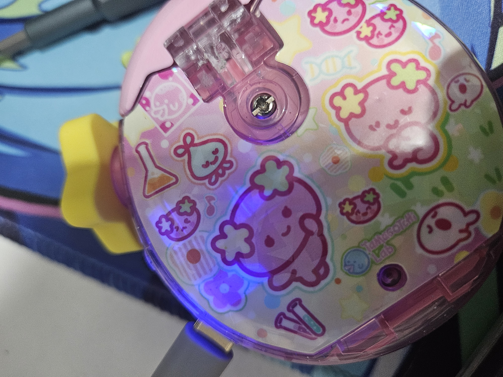

# Tamagotchi Paradise — Rechargeable LiPo Mod

Replace the stock AAA cells with a USB-C rechargeable LiPo pack. This tutorial covers two circuit options: Simple Version / Use During Charge Version.

## Choosing a version

- Build **simple** if you mainly charge overnight with the unit off and want fewer solder joints.
- Build **use-during-charge** if you play while plugged in — the P-MOSFET path keeps charge current and load current separate so the cell is not needlessly cycled during USB sessions.

| Version               | Charge while playing?               | Extra parts                             | Best for                                                  |
| --------------------- | ----------------------------------- | --------------------------------------- | --------------------------------------------------------- |
| **Simple**            | Yes — but better to charge with the device **off**, otherwise the battery lifespan will decrease faster than expectation | Charger + battery + switch + buck-boost | First build, fewest parts                                 |
| **Use-during-charge** | Yes — dual power path               | Above + P-MOSFET + Schottky + pull-down | Everyday use without cycling the battery while plugged in |



---

## How it works

Stock Paradise runs from **2× AAA ≈ 3.0 V**. This mod:

1. Charges a **3.7 V LiPo** from USB-C via a **TP4057** module (charge + protection).
2. Regulates that rail to **3.0 V / 3.3 V** with a **TPS63802** buck-boost so the host sees a stable logic supply.
3. Uses a **side slide switch** as the main power cut (modified 2-pin use of the stock toggle footprint / a mini SPDT).

### Simple circuit

Power always comes from the charger’s protected **OUT** through the switch into the buck-boost. While USB is plugged in, the TP4057 both charges the pack **and** can supply the load from the same node — so **turn the Tamagotchi off while charging** for better battery life and cooler operation.

#### Simple wiring diagram



#### Simple soldering map

Hold each module **silk / labels up**. Thick lines in the drawing are the hookup wires; dots are solder joints. There is **no** power-path PCB on this version.



Solder **1 → 3**, then **6 → 9**, then the LiPo (**4** and **5**) last.

1. Red: USB **VBUS** → TP4057 **IN+**
2. Black: USB **GND** → TP4057 **IN−**
3. Orange: TP4057 **OUT+** → switch **middle**
4. Red: LiPo **+** → TP4057 **BAT+**
5. Black: LiPo **−** → TP4057 **BAT−**
6. Orange: switch **right** → TPS63802 **VIN**
7. Red: TPS63802 **VOUT** → host **+**
8. Black: TP4057 **OUT−** → TPS63802 **GND**
9. Black: TPS63802 **GND** → host **−**

Ground is a chain (same net, three wires), not one shared rail. Host **+** / **−** are the leftover left-side springs (P6 / P7), screen facing you. Charge with the device **off**.

### Use-during-charge circuit

Two paths feed a shared **VSYS** node:

- **USB path:** `VBUS → SS14 Schottky → VSYS` — powers the device from USB while charging.
- **Battery path:** `TP4057 OUT+ → AO3401A (P-MOSFET) → VSYS` — powers the device from the LiPo when USB is unplugged.

When USB is present, **VBUS pulls the P-MOSFET gate high**, so the FET turns **off** and the LiPo is **not** loaded while it charges. When USB is removed, **R1 (100 kΩ)** pulls the gate to **GND**, the FET turns **on**, and the battery supplies VSYS.

#### Use-during-charge wiring diagram



#### Power-path truth table

| USB plugged in?             | Q1 (AO3401A[P-MOSFET]) | Device powered from | Battery                    |
| --------------------------- | ---------------------- | ------------------- | -------------------------- |
| Yes (VBUS high)             | **Off** (gate high)    | USB via **D1**      | Charging only (not loaded) |
| No (gate pulled down by R1) | **On**                 | LiPo via **Q1**     | Discharging into VSYS      |

Optional PCB for the power-path block only: see [`tama_power_path/`](tama_power_path/) (14×10 mm, pads `VBUS` / `BAT` / `VSYS` / `GND`).

#### Use-during-charge soldering map

Hold the assembled 14×10 mm board **silk up**. Thick lines in the drawing are the hookup wires; dots are solder joints. Match the pad names printed on your TP4057 / TPS63802 modules.



Solder **1 → 3**, then **6 → 11**, then the LiPo (**4** and **5**) last.

1. Red: USB **VBUS** = PCB **VBUS** = TP4057 **IN+**
2. Black: USB **GND** → TP4057 **IN−**
3. Blue: TP4057 **OUT+** → PCB **BAT**
4. Red: LiPo **+** → TP4057 **BAT+**
5. Black: LiPo **−** → TP4057 **BAT−**
6. Orange: PCB **VSYS** → switch **middle**
7. Orange: switch **right** → TPS63802 **VIN**
8. Red: TPS63802 **VOUT** → host **+**
9. Black: TP4057 **OUT−** → PCB **GND**
10. Black: PCB **GND** → TPS63802 **GND**
11. Black: TPS63802 **GND** → host **−**

Ground is a chain (same net, four wires), not one shared rail. PCB **GND** is required so **R1** can pull the FET gate down. Host **+** / **−** are the leftover left-side springs (P6 / P7), screen facing you.

---

## Parts list

### Common (both versions)

| Qty | Part                                                             | Notes                                                                                             |
| --- | ---------------------------------------------------------------- | ------------------------------------------------------------------------------------------------- |
| 1   | Tamagotchi Paradise                                              | Donor unit                                                                                        |
| 1   | USB Type-C female breakout / socket                              | Shell cutout on the side or bottom edge                                                           |
| 1   | TP4057 (or TP4056) LiPo charger + protection board               | Prefer modules with **IN / BAT / OUT** and DW01-style protection                                  |
| 1   | 902030 LiPo **3.7 V 500 mAh** (or similar that fits the AAA bay) | Use a **protected** pack or rely on the charger board’s protection                                |
| 1   | Mini slide switch (SPDT / SPST)                                  | Side cutout next to USB-C                                                                         |
| 1   | TPS63802 Mini buck-boost module                                  | Set / choose **3.0 V or 3.3 V** output                                                            |
| —   | Hookup wire (red / black), hot glue, Kapton tape                 | Strain relief + insulation                                                                        |
| —   | Tools                                                            | Screwdriver, soldering iron, flush cutters, needle files / Dremel, multimeter, ultra-sonic cutter |

### Extra for use-during-charge

| Qty | Part                    | Footprint / LCSC (KiCad BOM)                                       |
| --- | ----------------------- | ------------------------------------------------------------------ |
| 1   | **AO3401A** P-MOSFET    | SOT-23 · [C15127](https://www.lcsc.com/product-detail/C15127.html) |
| 1   | **SS14** Schottky diode | SMA · [C2480](https://www.lcsc.com/product-detail/C2480.html)      |
| 1   | **100 kΩ** resistor     | 0603 · [C25803](https://www.lcsc.com/product-detail/C25803.html)   |

Gerbers / CPL / BOM for the tiny power-path PCB: [`tama_power_path/fab/`](tama_power_path/fab/).

---

## Safety

- LiPo cells can ignite if shorted, crushed, or charged incorrectly. Work on a non-flammable surface; never leave a first charge unattended.
- Confirm **polarity** with a multimeter before closing the shell. Reversed battery wires will destroy the charger board and can damage the Paradise PCB.
- Do **not** hot-plug wires on a charged pack. Connect battery last; disconnect battery first when reworking.
- Keep metal tools and screws away from the exposed LiPo pouch and charger pads.
- If the pack swells, gets hot, or the charger LED behaves oddly, unplug USB and stop.

---

## Disassembly and Shell modification

1. Remove both AAA cells.
2. Remove the AAA battery case. Using ultra sonic cutter make you easier to remove the redundant shell plastic parts.
3. Remove the stock **+** and **−** spring contacts on the right hand side in terms of the screen facing to you side. The spring contacts is single piece of metal. Do not remove the one on left hand side, those are used for wiring the Power and GND.
4. Cut two adjacent rectangular openings on the side (or bottom edge) of the translucent shell
   - **USB-C** — sized to the female connector body so it sits flush / slightly recessed.
   - **Slide switch** — immediately above or beside the USB-C cutout.





---

## First power-on checklist

1. Switch **off**. No USB yet.
2. Measure LiPo voltage at **BAT+/BAT−** (typically ~3.7 V for a partial charge; do not connect a 0 V / damaged cell).
3. Plug in USB-C. Confirm the TP4057 charge LED (often red = charging, blue/green = done — check your module).
4. Measure **VSYS** (use-during-charge) or **OUT+** (simple): should rise with USB present.
5. Measure TPS63802 **VOUT** ≈ **3.0–3.3 V**.
6. Flip the slide switch **on**. Paradise should boot.
7. Unplug USB (use-during-charge): device should keep running from the LiPo without reboot if VSYS stayed up.
8. When the battery is charging, the red LED should light up. When the battery full of charge, a blue LED should light up.

<div style="display: flex; gap: 0px;">
  
  
</div>

---

## Repository layout

```
docs/                     Photos + soldering maps
  simple-solder.svg
  use-during-charge-solder.svg
tama_power_path/          KiCad project for the dual power-path PCB
  fab/                    Gerbers, BOM, CPL for ordering
```

---

## Disclaimer

This is an unofficial hardware modification. Opening the device voids warranties, risks permanent damage, and involves lithium batteries. Proceed only if you are comfortable with fine soldering and LiPo safety practices.
